# ERD: transactions rework (draft)

Status: agreed in conversation on 29 Oct 2026, not implemented. Model: facts only. Every amount is an exact integer in minor units of its own currency. Payments (money that moved) and lines (what it was spent on or earned from) are not tied by a database constraint: `internal/ledger` compares them by current rates and warns when they differ too much.

Go Savvy is a budget tracker, not a receipt store: a line is an amount for a category, not a product. There is no item catalogue, quantity or unit price.

The space schema gets a new base instead of 0001 + 0002, and v1.0 files are converted by Go code, not a SQL migration: see [Upgrade from v1.0](#upgrade-from-v10). Only `space/0001_initial` shipped (v1.0.1); 0002 and `group_uuid` never did, so there is nothing to convert for them.

```mermaid
erDiagram
    currencies ||--o{ accounts : "currency_id"
    currencies ||--o{ transaction_lines : "currency_id"
    accounts ||--o{ payments : "account_id (restrict)"
    categories ||--o{ transaction_lines : "category_id (restrict)"

    transactions ||--|{ payments : "transaction_id (cascade)"
    transactions ||--o{ transaction_lines : "transaction_id (cascade)"
    transactions ||--o{ transaction_tag : "transaction_id (cascade)"
    tags ||--o{ transaction_tag : "tag_id (cascade)"

    recurring_transactions ||--o{ recurring_instances : "cascade"
    transactions ||--o| recurring_instances : "transaction_id UNIQUE (set null)"

    space_transfers ||--o| payments : "space_transfer_uuid UNIQUE (restrict)"
    accounts ||--o| debts : "account_id (cascade)"

    transactions {
        INTEGER id PK
        TEXT type "income, expense, transfer, transfer_out, transfer_in, debt_lend, debt_borrow, debt_payment, debt_collection"
        TEXT description
        TEXT date
        TEXT status "pending, confirmed, skipped"
        INTEGER day_order "NULL = by id; set only by hand"
        TEXT external_id "NULL; not unique; importer adds a prefix"
        INTEGER created_by "server user, no FK"
        TEXT created_at
        TEXT updated_at
    }
    payments {
        INTEGER transaction_id PK "FK; WITHOUT ROWID, clustered by transaction"
        INTEGER account_id PK "FK; one payment per account in a transaction"
        INTEGER amount "signed, account currency; 0 only from v1.0 rows"
        TEXT space_transfer_uuid "NULL; set only on a payment on a space account"
    }
    transaction_lines {
        INTEGER transaction_id PK "FK; WITHOUT ROWID, clustered by transaction"
        INTEGER seq PK "0, 1, 2... order within the transaction"
        INTEGER category_id FK "NULL = uncategorised (v1.0 rows allow it)"
        INTEGER currency_id FK "one of the currencies of the payment accounts"
        INTEGER amount "> 0; sign comes from the transaction type"
        TEXT note "NULL; e.g. 'bank commission'"
    }
    transaction_tag {
        INTEGER transaction_id PK
        INTEGER tag_id PK
    }
    space_transfers {
        TEXT uuid PK
        TEXT payload "NULL only in review when this space lacks it; JSON: the signed bytes as signed, never re-encoded"
        INTEGER sig_v "1 = server key (v1.0, until re-signed); 2 = both space keys"
        TEXT source_kid
        TEXT source_sig "the source space's signature (sig_v 1: the server's)"
        TEXT destination_kid "NULL for sig_v 1"
        TEXT destination_sig "NULL for sig_v 1"
        TEXT source "generated from COALESCE(payload, remote): from.space_uuid"
        TEXT destination "generated from COALESCE(payload, remote): to.space_uuid"
        INTEGER version "generated from COALESCE(payload, remote)"
        TEXT status "confirmed, in_review"
        TEXT remote "NULL; JSON, the other space's version while in review; NULL there = the other space lacks it"
        TEXT updated_at
    }
    space_keys {
        TEXT kid PK
        TEXT seed "Ed25519 private seed; travels with the space's backup"
        TEXT created_at
        TEXT retired_at "NULL = current; retired keys only verify"
    }
    accounts {
        INTEGER id PK
        TEXT type "bank, crypto, cash, debt, space (at most one per currency)"
        INTEGER is_service "GENERATED VIRTUAL: type IN ('debt', 'space')"
        INTEGER currency_id FK
        INTEGER initial_balance "signed; a debt's opening amount when it has no issuance"
    }
    debts {
        INTEGER account_id PK "FK; the debt is an account of type debt"
        TEXT direction "i_owe, owed_to_me"
        INTEGER principal "> 0, account currency; the old target_amount"
        TEXT due_date "NULL"
        TEXT counterparty "NULL"
        TEXT note "NULL; the old debt_description"
        TEXT closed_at "NULL = open; the old is_paid_off"
    }
    recurring_transactions {
        INTEGER id PK
        TEXT template "JSON: what to create; the transaction input of the API"
        TEXT schedule "JSON: when; frequency, interval, day_of_week, day_of_month, start, end"
        INTEGER is_active
        TEXT error "NULL; why the rule was stopped (invalid template or schedule)"
        TEXT created_at
        TEXT updated_at
    }
    recurring_instances {
        INTEGER recurring_transaction_id PK
        TEXT due_date PK
        INTEGER transaction_id UK "NULL once the transaction is deleted; the due date stays handled"
    }
```

## Notes

- `categories`, `tags` and `currencies` are unchanged and shown only by their keys. `accounts` is shown only by the columns that matter here; it loses the debt columns (below). `recurring_transaction_tag` is dropped: tags move into the rule's `template`.
- Dropped from `transactions`: `account_id`, `to_account_id`, `amount`, `to_amount`, `is_estimated`, `category_id`, `dedup_hash`, `recurring_transaction_id`, `space_transfer_uuid`, `group_uuid`. `transaction_items` is dropped; its names go to `transaction_lines.note`.
- `recurring_transactions` keeps `id`, `is_active` and the timestamps. `type`, `description`, `account_id`, `to_account_id`, `category_id`, `amount`, `to_amount`, `is_estimated` and the tags move to the `template` JSON; `frequency`, `interval`, `day_of_week`, `day_of_month`, `start_date`, `end_date` to the `schedule` JSON. `next_run_date` and `last_run_date` are dropped: they are derived (below).
- **Payments.** Signed, in the account's currency. One per account in a transaction (the primary key), so change into the account that paid is just a smaller net amount. Change is a payment with the sign opposite to the transaction's direction, on another account, usually in another currency (pay in EUR, get change in RSD). A payment has no type column: its role follows from its sign and the transaction type.
- **Line.** One row says "this much, in this currency, for this category", with an optional note. "Bus 100" is one line. Several lines may share a category (for example a purchase and its commission, told apart by the note). The UI groups lines by category; the group is not stored.
- **Keys.** `payments (transaction_id, account_id)` and `transaction_lines (transaction_id, seq)`, both `WITHOUT ROWID`: a transaction's rows are stored together, with no `id` column and no separate `(transaction_id)` index. Saving a transaction rewrites its lines, so `seq` is renumbered from 0 and nothing refers to a line from outside.
- **Reports** read lines only, never payments. Change is not income, and a transaction counts only through its lines.
- **Transfer fee.** A transfer may have lines, with expense categories only: −100 EUR, +98 EUR and a "Fees" line of 2 EUR. The payments' net (−2) matches the lines, so the soft check needs no special case, and the fee is spending.
- **Estimated** is a property of a recurring rule, not of a transaction: a payment in the `template` may have `"estimated": true`. A pending occurrence shows it, derived from its rule through `recurring_instances`; once confirmed the flag means nothing.
- **Zero amounts.** v1.0 allows `amount = 0`. The migration writes no line of 0, so the database checks `transaction_lines.amount > 0`. A 0 payment is kept, because it is the only record of the transaction's account; the database allows 0 and the ledger rejects it on new input.
- **Ledger checks** (not in the database): a line's category type matches the transaction type (`expense` for a transfer, `transfer_out` and `transfer_in`); a line's currency is one of the currencies of all payment accounts, change included. Changing an account's currency can break the second rule for old rows; the soft check shows it, nothing is rewritten. A payment on a service account is allowed only through the internal path of the module that owns it: debts for `debt`, transfers for `space` ([space accounts](#space-accounts)).
- **Service accounts.** `accounts.is_service` is a generated column (`type IN ('debt', 'space')`), so the list of service types lives in one place and cannot drift from `type`. Queries filter on it (`WHERE NOT is_service` for pickers and account lists) instead of listing types; Go reads it as `Account.IsService()`, and the API sends `isService`, so the frontend never compares types. Only two checks stay per type: net worth counts debts but not space accounts (`internal/reports/networth.go`), and which module owns a service account (one switch in the ledger).
- **Recurring, what.** `template` is the transaction input of the API (type, description, payments, lines, tags), the same JSON and the same Go type as "create transaction", plus the recurring-only fields (`estimated`, a NULL amount). Whatever transaction can be created by hand, a rule can create, and a change to transactions changes rules with it; there is no mirror schema. The ledger validates the template when the rule is saved and again when an occurrence is generated. The JSON has no foreign keys, so the ledger does what keys would: an account used by a template cannot be deleted (today `ON DELETE CASCADE` silently deletes the rule); deleting a category leaves its template lines uncategorised and deleting a tag removes it from templates, as today. A template that still fails (for example a currency removed) stops its rule instead of generating: `is_active = 0`, the reason in `error`, shown in the UI; saving the rule again clears it. The startup job `recurring:ensure-upcoming` validates the `template` and `schedule` of every active rule before it creates anything, so a template broken outside the ledger (a restored backup, a manual edit, an old app version) is caught at start, not at the next occurrence.
- **Recurring, when.** `schedule` is the only JSON on the rule, validated by `internal/recurring` (the database checks only `json_valid`). No SQL reads it: there is no scheduler. A rule always has one pending occurrence; confirming or skipping it creates the next in the same database transaction (`AdvanceAfterOccurrence`), and `recurring:ensure-upcoming` only recovers after a crash. New kinds of schedule (last day of the month, second Monday) are new keys, not migrations.
- **Recurring, converted amounts.** At most one payment in a template may have a NULL `amount`: each occurrence then gets whatever balances the other payments and the lines, converted at that day's rates, and that payment is estimated. This covers a transfer's receiving side (`transferAmount` today) and a subscription priced in one currency and paid from an account in another. The occurrence stores the result as a fact; the rule stores no rate.
- **Recurring, derived.** The next due date is one step of `schedule` after `MAX(recurring_instances.due_date)`, or `start` when the rule has no occurrence yet. The last run is the latest confirmed instance. The API still returns `nextRunDate`, computed. Deleting an occurrence keeps its instance row with `transaction_id` NULL, so the derived date never moves back and a deleted occurrence is not generated again; deleting the pending one acts like a skip.
- **One pending occurrence per rule** holds by construction: the next one is created only when the previous one is confirmed or skipped, and its due date is fixed by the schedule, so `UNIQUE (rule, due_date)` stops a second creation (crash recovery) of the same occurrence. It replaces the old index `transactions_recurring_pending_unique`. Deleting a rule cascades to `recurring_instances` only: its transactions stay, and a pending one becomes an ordinary pending transaction (editable).
- **Debts.** A debt is still an account of type `debt`, so its money moves by payments like any other. Its own data moves from `accounts` to `debts`, one row per debt account: `debt_type`, `target_amount`, `due_date`, `is_paid_off`, `counterparty` and `debt_description` leave `accounts`, so no ordinary account carries them. Every debt operation is a transaction with two payments, one on an ordinary account and one on the debt account, in its own currency; there is no `debt_links` and no `to_amount`.
- **Debt sign.** The debt account's balance is signed like any account's: `owed_to_me` is positive (an asset), `i_owe` is negative (a liability), so net worth needs no special case. What is still owed is the absolute value; payment progress compares it with `principal`. Payments on the debt account by type: `debt_lend` +, `debt_collection` −, `debt_borrow` −, `debt_payment` +. A debt recorded without an issuance (origin "existing") starts from `initial_balance` = ±`principal`.
- **Debt types** stay on `transactions` (`debt_lend`, `debt_borrow`, `debt_payment`, `debt_collection`): the UI picks the icon from them, and filters and the MCP tools read them. Ledger checks keep them true to the payments: a `debt_*` transaction has exactly one payment on a debt account and one on an ordinary account, with the signs above and the debt's `direction` (lend and collection for `owed_to_me`, borrow and payment for `i_owe`); a payment on a debt account is allowed only in a `debt_*` transaction, so a plain transfer cannot bypass the debts module. Debt transactions have no lines, so reports skip them: repaying a debt is not spending.
- **Closing.** `closed_at` is set by the debts module when a payment brings the balance to 0 or past it, and cleared by reopen. Deleting a debt account cascades to `debts`; it is refused while the account has payments, as for any account.
- **Restrictions and space accounts.** See the sections below. Together they replace `guardRow`, the group cases and `space_transfer_payments`; there is no `locks` table.
- **`day_order`** stays: the id is kept by the migration, so the order does not change.
- **Deletes.** An account or category used by a payment or line cannot be deleted (restrict). Deleting a category reassigns its lines first, as `UpdateTransactionsCategory` does today. Deleting an account is refused while it has payments, as `CountAccountTransactions` does today. Today a debt with only its issuance can be deleted together with it (`DeleteDebtIssuance`); the debts module keeps that by deleting the issuance first.
- **External id** is not unique, so the importer alone prevents duplicates (the old `UNIQUE (account_id, dedup_hash)` goes away). That is enough while imports run in one process.

## Restrictions

What may be done with a transaction is never stored. Every reason that restricts it follows from facts already in the database, so nothing can get out of step with them:

| Reason | Derived from |
|---|---|
| `debt` | a payment on an account of type `debt` |
| `space_transfer` | a payment with `space_transfer_uuid` |
| `transfer_review` | that payment's `space_transfers.status = 'in_review'` |
| `recurring_pending` | `status = 'pending'` and a `recurring_instances` row |

- One map in the code gives each reason the actions it allows, in the bits of `TxActions` (edit, delete, duplicate, confirm, skip) plus `edit_details` (description, tags and the categories and notes of lines, but not payments, date or type), and the message shown in the UI. A reason missing from the map allows nothing.
- `Transaction.Allowed()` = actions from status, AND the actions of every reason that applies. The API passes the flags and the reasons on. Update and delete return the same refusal.
- The owning module (debts, transfers, recurring) acts through an internal path that skips `Allowed()` for its own reason only.
- The reasons are loaded with the transaction (the list query joins the payments' account types, the transfer status and `recurring_instances`), not one query per row.
- Changing what a reason allows is a code change only; a new reason is a new derivation and a map entry, never a migration.
- Test: every `debt_*` row has exactly one payment on a debt account; every reason is derived for its fixture and not for an ordinary transaction.

The matrix below is that map plus the status rules. It is a table test.

| Transaction | Edit | Delete | Duplicate | Confirm | Skip | Edit details |
|---|---|---|---|---|---|---|
| income, expense, transfer, confirmed | yes | yes | yes | | | |
| same, pending, entered by hand | yes | yes | yes | yes | | |
| same, pending, `recurring_pending` | | | | yes | yes | |
| skipped | | yes | | | | |
| `space_transfer` | yes, except that payment and the date; those through `internal/transfers` | through `internal/transfers` | | | | |
| `space_transfer` and `transfer_review` | | | | | | |
| `debt` | | | | | | yes (description and tags; debt rows have no lines) |

## Space accounts

Money that goes to or comes from another space passes through a **space account**: an account of type `space` that stands for all other spaces in one currency. There is at most one per currency (a partial unique index), made on first use and named by the app ("Other spaces · EUR"); no extra table. It is a service account (`is_service`), like a debt. One per currency keeps every amount exact: the exchange between the two spaces' currencies lives in the signed record, never in a space account.

- **Each side is an ordinary transaction with payments.** The payment on the space account carries `space_transfer_uuid`: that payment is the cross-space movement. Examples, each side in its own currency:

  | Case | Source space | Destination space |
  |---|---|---|
  | plain transfer | `transfer_out`: card −100 EUR, space · EUR +100 | `transfer_in`: shared account +11 700 RSD, space · RSD −11 700 |
  | shared purchase paid with a member's card | `transfer_out`: card −40 EUR, space · EUR +40 | `expense`: space · EUR −40, line Groceries 40 EUR |

- **Space payments** (the second row) need nothing special: an expense paid from the space account. No account of the destination space changes, and its lines count in its reports and budgets. The sender may add an expense line (say "Family & kids") to count the money as their own spending too.
- **The rest is an ordinary transaction.** Lines, notes, tags, description and the other payments edit as usual, so a shared purchase can mix shared accounts with members' cards.
- **What only `internal/transfers` changes:** the payment on a space account, the real payment it pairs with on the source side, the transaction's date, and deleting the transaction. It needs the editor role in both spaces and updates the transfer (new version, signed by both keys) and the other side in one step. The ledger refuses these on every other path with a reason, as it refuses a payment on a debt account outside the debts module.
- **Ledger checks:** a payment on a space account appears only in `transfer_out` (source side), `transfer_in` (destination) or `expense` (a space payment, destination); a transaction has at most one such payment; its amount is `+from.amount` on the source side and `−to.amount` on the destination, and its currency is that side's currency in the record; the transaction's date is the record's date.
- **Payments are updated in place,** not deleted and rewritten, when a transaction is saved, so `space_transfer_uuid` stays on its payment. Lines are still rewritten.
- **Which space.** A space account mixes all linked spaces; the other space of a payment is `source` or `destination` of its `space_transfers` row, so "exchanged with Alice" is a join, not an account balance.
- **Reports and balances.** Net worth and account lists leave space accounts out; pickers never offer them. The flows on space accounts are what came from and went to other spaces (the contributions next to income in overview, cash flow and money flow).
- **Types.** `transfer_out` and `transfer_in` stay, for the icon and the filters; they follow from the sign of the space-account payment and the ledger checks they match. A shared purchase paid from another space is an `expense`. The types do not restrict anything themselves.
- **Not copied:** duplicate is not offered for a transaction with a space-account payment, and a recurring template cannot hold one (it would need rights in two spaces at every occurrence).
- **Unlink, restore, frozen.** As today: a transfer whose other space is missing is frozen, which now means only its payment on the space account and the date cannot change. A transfer whose local account is missing has no payment carrying its uuid (the old `needs_attention`). Space accounts are never deleted while they have payments.
- **Tests.** Every `transfer_in` and `transfer_out` row from v1.0 has its real payment and a space-account payment with the uuid; each refused path (edit the space-account payment, its paired payment or the date, delete, duplicate, a template with one) returns the reason; editing lines, tags and other payments works; the uuid survives saving the transaction; a space payment counts in the destination's reports and changes none of its accounts.

## Space transfers

The signed record moves from columns to JSON, and transfers are signed by both spaces' keys instead of the server's ([below](#signing-with-space-keys)). The transactions rework does not need either, so they can land in their own commits; the converter still has to write the new table shape.

- **Payload.** `payload` holds the exact bytes the server signed (`transferPayloadV1` today). A signature is checked over the stored bytes, not over JSON rebuilt from columns, so a rebuild that differs by one byte can no longer freeze a transfer. A new format (a fee, several accounts per side) is new keys and a new `sig_v`, not a table migration; old records keep verifying because their bytes never change. The JSON keys stay `from` and `to`: they are part of the signed format.
- **Why JSON.** No SQL sums these amounts: balances and reports read the mirror's payment. The same reason as `template` and `schedule` on recurring rules.
- **Generated columns.** `source`, `destination` (the space uuids) and `version` are `GENERATED ALWAYS AS (COALESCE(payload, remote) ->> ...) VIRTUAL`, so the indexes and the sync's version comparison work without a second copy.
- **Status** is local bookkeeping, not signed and not synced: `confirmed` or `in_review` (a difference with the other space found after a restore). The old `review` column goes; its kind follows from `payload` and `remote` of an `in_review` row, which `resolve` branches on:

  | `payload` | `remote` | kind |
  |---|---|---|
  | NULL | set | `created_remote`: only the other space has it |
  | set | NULL | `missing_remote`: only this space has it |
  | live | has `deleted_at` | `deleted_remote` |
  | set | set, otherwise | `changed_remote` (including a local tombstone against a live remote) |

  A `confirmed` row always has `payload` and no `remote` (a CHECK). The old `needs_attention` (this side's account is missing) is not stored: such a transfer has no mirror, so no payment carries its uuid.
- **Signature columns** describe `payload`. For `created_remote` (`payload` NULL) the other space's record is verified when the review is opened, as `reviewOne` does today; accepting it moves `remote` into `payload` with its signatures, so `remote` holds the whole record JSON (payload, `sig_v`, both kids and signatures), as it does today.
- **Mirror.** Each side is a transaction whose payment on a space account carries the uuid: see [Space accounts](#space-accounts). `payments.space_transfer_uuid` restricts deletes of `space_transfers`, so `internal/transfers` deletes the transaction before a `space_transfers` row; usually the row is a tombstone (`deleted_at`) anyway. The record's `account_id` on each side is the local account the money left or reached: a real account, or the space account for a space payment, so the signed format needs no null account.
- **Migration** is part of the v1.0 converter, in Go: the payload must be byte-identical to what `json.Marshal` produced when signing (Go escapes `<`, `>`, `&`; key order and nulls must match), which `json_object` does not guarantee. Each row is rebuilt with a frozen copy of `transferPayloadV1` and stored with `sig_v` 1 and the server's kid and signature in `source_*`. `ok` and `needs_attention` become `confirmed`; `pending` becomes `in_review`, and a `created_remote` row moves its record into `remote` and gets `payload` NULL.

### Signing with space keys

Goal: a transfer stays valid when both of its spaces move to another server together (a server backup, or both space backups restored there), and cannot be forged by someone who holds only one of them.

- **Keys.** Every space has its own Ed25519 key in `space_keys`, made when the space is created (and by the converter for v1.0 spaces). Unlike the server key, it lives in the space file and travels with its backups: that is what lets a transfer move with its spaces. Copying from another space at creation never copies keys. The API never returns a seed.
- **Two signatures.** A transfer is signed by both spaces' current keys over the same `payload`, `source_*` and `destination_*`. Both spaces are open on the server when a transfer is made or changed, so it signs with both at once.
- **Verify only when both spaces are here.** A signature is checked against the keys in its own space's file (current or retired), read from the live file on this server, never against a key copy held by the other space. So a transfer is valid exactly when both spaces are on this server and each one's key signed it. When the other space is missing (unlinked, or only one backup brought over), the transfer is frozen, as today.
- **What it protects.** The admin of one space has only that space's key. A restored backup of space A with a forged or edited transfer fails the check by B's key, read from B's own file: the existing review catches it. Replacing A's key in A's backup does not help, since B's signature is still needed. Whoever holds both spaces (their admins together, or the server admin) can sign anything between them; that is no loss, as they can edit both spaces anyway.
- **Rotation.** A new key retires the old one (`retired_at`); retired keys still verify and are never deleted while a transfer signed by them exists.
- **v1.0 transfers** keep `sig_v` 1 (the server key) after the converter. At startup, once every space is converted, `internal/transfers` re-signs each `sig_v` 1 row whose server signature verifies and whose two spaces are both here: `sig_v` 2, both space keys, written to both spaces in one step. A row that fails stays `sig_v` 1 and frozen until it can be re-signed. The server key keeps signing backup manifests; it no longer signs transfers.
- **Docs.** `docs/spaces.md` "Linked spaces and transfers": moving both spaces to another server keeps their transfers; only one of them alone freezes them.

## Upgrade from v1.0

The space set starts again from one base file with the whole v1.1 schema. v1.0 files are converted by Go code into a fresh file, not altered in place.

- **Base.** `internal/migrate/sql/space/0001_base.sql` replaces `0001_initial.sql` and `0002_transactions.sql`. It needs a new name: a v1.0 file has `space/0001_initial` recorded, so a base under that name would count as applied. `Up` refuses a file that has `space/0001_initial` and not the base, so the base's `CREATE TABLE IF NOT EXISTS` can never run over v1.0 tables. The server set is unchanged.
- **Package.** `internal/migrate/v1` ("from v1.0"), not `internal/legacy`, which is for Laravel only. It holds the frozen `0001_initial.sql` (for its tests and as the shape the Laravel restore produces), a frozen copy of `transferPayloadV1` (`migrate` sits below `transfers` and cannot import it), and the conversion. It works at the store level, as `internal/store/sqlite/sanitize.go` does.
- **How.** Create a fresh file from the base, ATTACH the v1.0 file read-only with `trusted_schema` off, copy with the [mapping below](#v10-migration-0001-row-to-the-new-shape) in one transaction, generate the space key, run `pragma_foreign_key_check`, then swap the files; the v1.0 file is kept as a backup. A fresh file is simpler than rebuilding tables in place and leaves a rollback for free.
- **Where it runs.**
  - At startup, for every space file still at v1.0. The pre-migration backup that `Store.Pending` drives today happens first.
  - When a v1.0 space backup is uploaded. `sanitize` copies the columns both files share, so a v1.0 `transactions` table would come through half empty and without an error; it must detect a v1.0 file (by `schema_migrations`) and convert it instead.
  - After a Laravel restore, which produces a v1.0 file: Laravel to v1.0 to v1.1. `legacy` itself does not change.
- **Order at startup.** Convert every space, then re-sign the v1.0 transfers (above); re-signing needs both spaces of a transfer converted.
- **Tests.** Fixture v1.0 files (one per row kind in the mapping, plus the transfer cases) converted and compared with the expected new rows; a v1.0 backup through `sanitize`; a Laravel file through restore and the converter; `Up` refusing a v1.0 file.

## Indexes

Every foreign key column first in some index (`TestForeignKeysAreIndexed`).

- `transactions (date)`, `transactions (external_id) WHERE external_id IS NOT NULL` (not unique).
- `payments`: the primary key `(transaction_id, account_id)` serves the foreign key and the list; `(account_id, transaction_id, amount)` for balances.
- `transaction_lines`: the primary key `(transaction_id, seq)` serves the foreign key and the list; `(category_id, currency_id, amount)` for reports; `(currency_id)` for the foreign key.
- `debts`: the primary key serves the foreign key; no other index (a space has few debts).
- `space_transfers (source)`, `space_transfers (destination)`, on the generated columns.
- `payments (space_transfer_uuid) WHERE space_transfer_uuid IS NOT NULL`, unique: one payment per side of a transfer.
- `accounts (currency_id) WHERE type = 'space'`, unique: one space account per currency.

## v1.0 migration (0001 row to the new shape)

| Old row | New |
|---|---|
| income | 1 payment `+amount`, 1 line (category, account currency, `amount`) |
| expense | 1 payment `-amount`, 1 line |
| transfer | payment `-amount` on `account_id`, payment `+COALESCE(to_amount, amount)` on `to_account_id`; no line. A transfer from an account to itself becomes one payment of the net (`COALESCE(to_amount, amount) - amount`) |
| `transfer_in`, `transfer_out` | type kept. 2 payments: on `account_id` as `AccountDailyDeltas` moved money (`+amount` / `-amount`), and the opposite amount on the space account of that account's currency (created if missing) with `space_transfer_uuid`. No line |
| `debt_*` | type kept. 2 payments: on `account_id` as `AccountDailyDeltas` moved money (`+amount` for `debt_collection`, `debt_borrow`; `-amount` otherwise), and on `to_account_id` `COALESCE(to_amount, amount)` with the debt sign (see the notes: + for `debt_lend`, `debt_payment`; − for `debt_borrow`, `debt_collection`). `category_id` is dropped: the app never sets it on debt rows (only Laravel-era rows may have one) |
| debt account | `debts` row from `debt_type` (`direction`), `target_amount` (`principal`), `due_date`, `counterparty`, `debt_description` (`note`), `is_paid_off` (`closed_at` = `updated_at`, or now). `initial_balance` = ±(`target_amount` − the issued `to_amount`s), + for `owed_to_me`, − for `i_owe`, so the balance equals the old `target − paid`. `accounts` is rebuilt without the debt columns |
| `transaction_items` | not a table any more. The trimmed names, in the order of the item ids, joined with `, `, become the `note` of the transaction's line; quantities and prices are dropped |
| `is_estimated` | dropped on transactions; on a recurring rule it goes to the payments in its `template` |
| recurring rule | `template` = `json_object` of type, description, payments and line as for a transaction of its type, and tags from `recurring_transaction_tag` (`json_group_array`); `to_amount` NULL stays NULL on the receiving payment (see the note on converted amounts); `schedule` = `json_object` of the old schedule columns; `next_run_date`, `last_run_date` dropped. The pending occurrence's `due_date` is the rule's `next_run_date` (not the transaction's date, which may have been edited); a rule with no instance gets `start` = `next_run_date` when that is later, so the derived date matches |
| `dedup_hash` | `external_id = 'csv:' \|\| account_id \|\| ':' \|\| dedup_hash`, so a CSV imported before the upgrade is not imported twice after it |
| amount 0 | a payment of 0, no line |

Row ids are kept, so tags and `day_order` stay valid. Sequences are restored so no id is reused.
